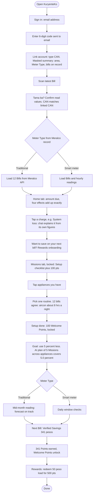
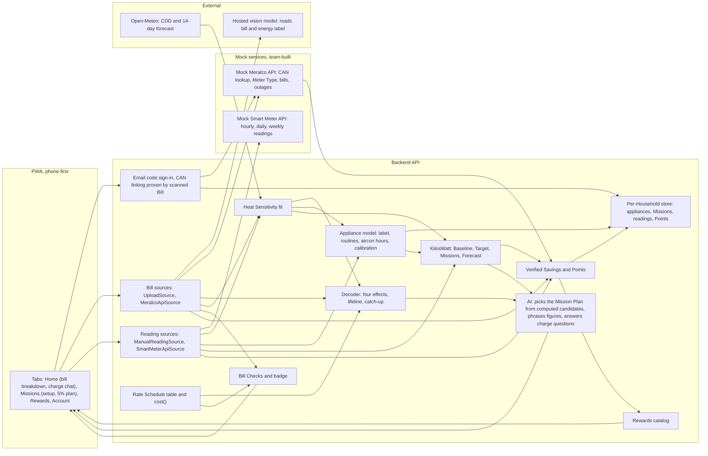

# KuryenteKo: Bakit ganito ang bill ko?

**Event:** Meralco Power Academy x Meralco, *Digital Sparks (IDOL Hackathon 2026)*
**Challenge:** #2 Know Your Bill, Manage Your Usage
**Team:** LarpItOut (University of Caloocan City)

> **One-liner:** *"Hindi lang namin ipinapaliwanag ang bill mo. Sinasagot namin kung saan napunta ang bawat pisong itinaas, kung tugma ba ito sa sariling record ng Meralco, at ginagantimpalaan ka kapag napababa mo ang susunod."*

**Merged plan.** This doc combines the two Challenge 2 ideas: **KuryenteKo** (bill audit, account history, plain-Tagalog answers) and **KilosWatt** (exact "why it changed" math, Missions). **KilosWatt** is the name of the usage-management part inside KuryenteKo: Target, Missions, Forecast, Points and Rewards. [`KilosWatt.md`](./KilosWatt.md) points here.

Capitalised terms (Bill, Meter Type, Bill Check, Habit Effect, Verified Savings, Points…) are defined in [`GLOSSARY.md`](../../GLOSSARY.md). Decisions: [ADR-0001](../adr/0001-bill-change-by-recomputing-the-bill.md) (how the Bill Change is split), [ADR-0002](../adr/0002-no-dispute-filing-only-bill-checks.md) (why the app never files complaints), [ADR-0003](../adr/0003-bill-only-verdict-stops-at-rate-and-days.md) (superseded by ADR-0005), [ADR-0004](../adr/0004-setup-earns-locked-welcome-points.md) (Welcome Points for Household Setup), [ADR-0005](../adr/0005-email-otp-sign-in-and-can-linking.md) (email sign-in and CAN linking), [ADR-0006](../adr/0006-setup-by-tapping-appliances-and-one-routine.md) (light Household Setup), [ADR-0007](../adr/0007-missions-as-a-five-percent-plan.md) (Missions as a 5% plan).

**Diagrams:** [Happy-path user flow](#3-happy-path-user-flow) and [Architecture](#9-architecture) are Mermaid. To edit them in Excalidraw: *More tools → Mermaid to Excalidraw*, paste the code block.

---

## 0. What we decided (grilling sessions, Nov 12)

**Revised Nov 12 evening** (flow review with the high-fidelity [mockup](https://claude.ai/artifact/DFJ51QmxG5t6DhTbkraBuf), private until shared): sign in first with an email code, link the Household by CAN, then scan; Home tab is the bill breakdown; Missions tab holds a 5% plan. Rows marked *(rev)* changed.

| Topic | Decision |
|---|---|
| Name | **KuryenteKo**; KilosWatt = the usage-management part |
| Login *(rev)* | **Email + 6-digit code** (standard consumer sign-in, no password). The email is not tied to any Meralco account. Sign-in comes first; there is no no-login scan ([ADR-0005](../adr/0005-email-otp-sign-in-and-can-linking.md)) |
| Linking a Household *(rev)* | Type the **CAN** → masked summary (area, Meter Type, Bills on record) → scan the latest Bill → if it shows the same CAN, the link activates and the 12-bill Bill History unlocks. The scanned Bill is the ownership check. The Bill-only Verdict ([ADR-0003](../adr/0003-bill-only-verdict-stops-at-rate-and-days.md)) is dropped |
| Household *(rev)* | One Meralco service, linked by its **CAN**. Appliances, Missions, readings and Points are saved **per Household**, not per login. One owner per Household |
| Two customer types | **Meter Type** comes from Meralco's record for the Household. **Traditional:** Bill upload + Bill History from the (mock) Meralco API. **Smart meter:** the (mock) smart meter API sends hourly / daily / weekly readings; Bills and history are auto-loaded |
| Home *(rev)* | Bottom tabs: **Home · Missions · Rewards · Account**. The Home tab *is* the bill breakdown: amount due, four effects, and tappable charge lines (generation, distribution, system loss, transmission, taxes…). Tapping a charge opens a **stateless chat** about that line. At the bottom: "Want to save on your next bill?" → rewards onboarding → setup |
| Why it changed | Rebuild the Bill from the Rate Schedule with `cost()`; four effects that add up exactly; lifeline / catch-up lines when they apply |
| Weather | **Heat Sensitivity** learned from the household's 12 Bills; aircon survey only as fallback |
| Leftover | **Habit Effect**; a big one is a **Usage Outlier** (yellow), never "Meralco's fault" |
| Is the bill right? | **Bill Checks** compare Meralco's own figures only; red → "Itanong kay Meralco" + copyable summary. **The app never files complaints** |
| Bill explanation | Personal, line by line, on a redrawn Bill (beyond Meralco's general "Understand your bill" page) |
| Appliances *(rev)* | Part of Household Setup: **tap the appliances you have** (with counts) and pick **one routine** for the whole home; typical kWh per appliance; total calibrated to the Bill. Aircon photo optional ([ADR-0006](../adr/0006-setup-by-tapping-appliances-and-one-routine.md)) |
| Missions *(rev)* | Goal: **use 5% less electricity** this period. Code computes candidate Missions across all appliances; AI picks a plan of up to five that reaches ~5%, words it, and can shuffle or swap ([ADR-0007](../adr/0007-missions-as-a-five-percent-plan.md)). **Traditional: one billing period**, verified by the next Bill. **Smart meter: daily / weekly** window checks |
| Points | **1 point = ₱1 of Verified Savings**: weather- and days-adjusted, never self-reported, brownouts excluded |
| Rewards | **Partner-funded** catalog (load, e-wallet, vouchers), sample items in the demo. Never a Meralco bill discount |
| Forecast | Range from history + weather forecast; narrows with a Mid-month Reading (traditional, typed) or updates daily (smart meter) |
| Cut | Dispute pack, staff inbox, area map, blackout reports, know-your-rights card, analog dial model, language toggle, smart-meter-based appliance breakdown, family teams, leaderboard |

---

## 1. The Problem

- **The bill shows what you owe, not why.** No one says which charges you control, or that generation and transmission are pass-through and not Meralco's income.
- **When the bill rises, nobody knows the cause.** Rate, a longer billing period, heat, or habits? Households panic, blame Meralco, or call the hotline. 2026 saw a spike in bill complaints.
- **People can't tell if the bill is right.** They have no basis to judge it.
- **Advice is generic, and saving has no visible payoff.** "Magtipid" says nothing about which change matters, and nothing rewards the effort.
- **Two kinds of homes.** Most have only a monthly bill; around 196,000 smart meter homes (Feb 2026) have interval data that today's tools barely use.

**Existing tools:** the My Meralco app shows the bill, history, and an appliance calculator; [Meralco's "Understand your bill"](https://www.meralco.com.ph/residential/understand-your-bill) explains charges **in general**. No one explains **your** bill, why **it** changed to the peso, or checks it against Meralco's own figures.

### Persona

**Aling Rosa, 45, Caloocan.** Her October bill is ₱6,817, up ₱937 from September. She almost called Meralco to complain. She does not know if it was the rate, the aircon, the heat, or a billing mistake.

---

## 2. Features

### 2.1 Know your bill

| Feature | Traditional meter | Smart meter |
|---|---|---|
| **Getting the data** | Email sign-in → type CAN → photo of the latest Bill → AI reads it → "Tama ba?" → CAN matches → 12 Bills from the (mock) Meralco API | Email sign-in → type CAN → one Bill scan to prove the CAN → Bills and 12 months of readings auto-loaded |
| **Home tab** | Amount due, due date, badge, the four effects, tappable charge lines, "Want to save on your next bill?" | Same, plus "Ngayong buwan hanggang ngayon: 210 kWh" |
| **Bakit ganito?** (hero) | Bill Change split into Rate, Billing Days, Weather, Habit Effects; lifeline / catch-up lines when they apply; credits and adjustments listed below; ✓ adds up to the real change | Same |
| **Tama ba ito?** | 🟢 / 🟡 / 🔴 badge from Bill Checks and Usage Outlier (§2.4) | Same |
| **Ano'ng laman ng bill ko?** | Charge lines on Home are buttons; tap one → bottom-sheet chat: "Bakit tumaas ito?" answered from that line's own figures (amount, change, pass-through vs. Meralco's own); suggested question chips; stateless; never files anything | Same |
| **Usage chart** | — | Hourly / daily / weekly kWh |

### 2.2 Appliances (part of Household Setup, [ADR-0006](../adr/0006-setup-by-tapping-appliances-and-one-routine.md))

**1. Tap the appliances you have.** A grid: aircon, refrigerator, electric fan, TV, washing machine, rice cooker, flat iron, computer, other. A tap adds one; another tap adds a second. No wattage, model or label needed. kWh per hour comes from typical values (Meralco appliance calculator figures), tagged **Typical value**. Optional: snap the aircon for a closer size estimate, tagged **Estimated from photo**. The DOE label scan stays available but is not part of setup.

**2. One routine for the whole home.**

| Question | Choices |
|---|---|
| When is someone usually home? | Almost all day · Evenings and weekends · Mostly daytime |
| When is the aircon usually on? | Sleeping only · Afternoon + night · Most of the day |

Code turns the routine into hours per appliance (ref and Wi-Fi 24 h; lights, TV and fans follow home hours; laundry and iron a few times a week). **Traditional:** the 12-bill cooling load estimates aircon hours and is shown as agreement: *"Your 12 bills agree: about 8 hours a night."* **Smart meter:** the hourly pattern plays the same role (#14).

**Calibration.** All appliance kWh are scaled so the total equals the Bill's kWh. Errors only shift the split between appliances, never the total. We never claim to detect an appliance; estimates are labelled.

### 2.3 Manage your usage (KilosWatt)

| Feature | Traditional meter | Smart meter |
|---|---|---|
| **Saan napupunta?** | Appliance breakdown, calibrated to the Bill (shown on the Missions tab and in each Mission's "why") | Same (from setup, not from readings) |
| **Goal** | **Use 5% less** than the weather- and days-adjusted Baseline, shown in kWh and pesos | Same |
| **Missions** | A **Mission Plan** of up to five across appliances that reaches ~5%; AI picks and words it, shuffle / swap; each shows its share of the goal and ~₱ | Same, each with a daily or weekly time window |
| **Forecast** | Range from history + 14-day weather; narrows after a typed Mid-month Reading; heat wave banner | Updates daily from readings; heat wave banner |
| **Verified Savings & Points** | At the next Bill | Per Mission window, daily |
| **Rewards** | Spend Points on partner rewards | Same |

### 2.4 "Tama ba ito?" badge

| Badge | When | Action |
|---|---|---|
| 🟢 **Tugma ang bill** | All Bill Checks pass, no Usage Outlier | Missions |
| 🟡 **Mas mataas kaysa karaniwan mo** | Usage Outlier: Habit Effect far above what history predicts for this weather | "May nagbago ba sa bahay?" → Missions. **Never** "itanong kay Meralco" |
| 🔴 **May hindi tugma** | A Bill Check fails | Show both Meralco figures; "Itanong kay Meralco"; copy summary. The app files nothing |

**Bill Checks (Meralco's figures only):** (1) lines add up to the total; (2) previous reading = last Bill's present reading; (3) per-kWh rates = published Rate Schedule; (4) payments before the bill date reflected in the balance.

### 2.5 Mission catalog

**Mission Plan ([ADR-0007](../adr/0007-missions-as-a-five-percent-plan.md)).** Code computes every candidate below that the household's appliances allow, with kWh, ₱ and share of the 5% goal. The AI picks up to five that together reach about 5%, writes them for this home, and can shuffle or swap; the server rejects any id that is not a candidate and falls back to a deterministic pick. Example plan: aircon off 1 h earlier (3.0%), iron once a week (0.7%), ref at medium (0.6%), lights off in empty rooms (0.4%), unplug standby (0.3%) = 5.0%, ~₱341.

Code computes every value; the AI only picks the wording. Each `rate` without a source is an **assumption, labelled in the app** until the team finds a DOE or Meralco figure.

| Mission | kWh saved per period | Smart meter window check | Source |
|---|---|---|---|
| Aircon at 25°C instead of current setting | `aircon_kwh × r_temp × (25 − current_setting)` | Night (10 PM–6 AM) kWh vs. the same window's baseline | `r_temp`: **assumption, find DOE/Meralco tip** |
| Aircon off 1–2 hours earlier (sleep timer) | `aircon_kw × hours_cut × days` | 4–6 AM kWh below the base-load level on ≥5 of 7 days | Physics (label kW) |
| Electric fan for the first hour instead of aircon | `(aircon_kw − fan_kw) × 1 × days` | First hour of the night window | Physics (label kW) |
| Unplug TV and gadgets at night | `standby_w × 8 × days / 1000` | 1–5 AM base load drops | `standby_w`: **assumption** |
| Lights off in empty rooms | `light_w × hours_cut × days / 1000` | Evening window | Physics (survey) |
| Plantsa once a week, all at once | `iron_kwh × r_batch` | — (monthly only) | `r_batch`: **assumption** |
| Full loads only for washing | `loads_cut × kwh_per_load` | — (monthly only) | Label / survey |
| Ref at medium setting, not max | `ref_kwh × r_ref` | — (monthly only) | `r_ref`: **assumption** |

Missions marked "monthly only" are offered to smart meter homes too, verified at the Bill like traditional.

### 2.6 Points and Rewards

- **1 point = ₱1 of Verified Savings.** A Mission's peso value is also its expected points.
- **Traditional:** at the next Bill, `points = cost(baseline) − cost(actual)` if positive, with the Baseline adjusted for weather and billing days.
- **Smart meter:** per Mission, daily: `(baseline_window_kWh − actual_window_kWh) × ₱/kWh`, for days the window condition is met.
- **Never self-reported.** Tapping "tapos na" earns nothing.
- **Welcome Points (ADR-0004):** finishing Household Setup grants 100 pts once per Household, shown at once but locked until the first Verified Savings. Setup is the locked state of the Missions tab (household info, appliance tap grid, routine), reached from "Want to save on your next bill?"; Missions stay locked behind it.
- **Brownouts excluded:** days (smart meter) or periods (traditional, from Meralco's record) with a recorded outage don't count.
- **Rewards:** a partner-funded catalog priced in points (e.g. ₱50 load = 500 pts, so rewards are a 10% top-up on money already saved). Demo items are labelled "sample rewards". Never a Meralco bill discount.

---

## 3. Happy-path user flow

Traditional meter (Aling Rosa), with the smart meter branch. Screens: [mockup](https://claude.ai/artifact/DFJ51QmxG5t6DhTbkraBuf).



**Off the happy path (not drawn):** 🟡 Usage Outlier → "May nagbago ba sa bahay?" → Missions. 🔴 Bill Check fails → show both figures → "Itanong kay Meralco" → copy summary. Scanned Bill's CAN differs from the typed CAN → "This bill belongs to a different account" and the link stays inactive. CAN already owned by another login → refused, contact the owner. "Maybe later" on rewards onboarding → Home; the Missions tab keeps the setup checklist.

---

## 4. Computation Logic (pseudocode)

```
# Rebuild any Bill from a Rate Schedule (table: per-kWh charges, fixed charges, lifeline, tiers, VAT)
cost(kwh, days, schedule) -> pesos

# ---------- Heat Sensitivity (12-bill Bill History; smart meter: daily readings) ----------
fit kwh_per_day = base + s * cdd_per_day          # least squares; s = Heat Sensitivity
predicted_kwh_per_day(c) = base + s * c
sigma = std(residuals)
# no history: s from the aircon survey

# ---------- Bakit ganito? ----------
rate_effect    = cost(kwh_now, days_now, sched_now) - cost(kwh_now, days_now, sched_before)
kwh_days_only  = (kwh_before / days_before) * days_now
days_effect    = cost(kwh_days_only, days_now, sched_before) - cost(kwh_before, days_before, sched_before)
kwh_weather    = kwh_days_only + s * (cdd_per_day_now - cdd_per_day_before) * days_now
weather_effect = cost(kwh_weather, days_now, sched_before) - cost(kwh_days_only, days_now, sched_before)
habit_effect   = cost(kwh_now, days_now, sched_before) - cost(kwh_weather, days_now, sched_before)
check: rate + days + weather + habit == cost(now) - cost(before)          # exact by construction
# lifeline / catch-up split out of habit_effect when they apply; credits and adjustments listed separately


# ---------- Tama ba ito? ----------
usage_outlier = kwh_now / days_now > predicted_kwh_per_day(cdd_per_day_now) * 1.30 and no household change
checks = [lines_sum == total, prev_reading == last.present_reading, rates == published, payments reflected]
badge  = RED if any check fails else (YELLOW if usage_outlier else GREEN)

# ---------- Appliances ----------
kwh_per_hour[a] = photo_estimate(aircon)  or  typical(type)                # setup: tap grid + counts
hours[a]        = routine_hours(a, home_pattern, aircon_pattern)      # one routine for the whole home
# aircon, traditional: cooling_kwh_per_day = s * cdd_per_day_now
hours[aircon]   = cooling_kwh_per_day / kwh_per_hour[aircon]          # then user confirms
# aircon, smart meter: sustained step ≈ aircon kW in hourly readings, growing with heat → user confirms
raw[a]          = kwh_per_hour[a] * hours[a] * days_now
est_kwh[a]      = raw[a] * (kwh_now / sum(raw))                       # calibrate to the Bill

# ---------- KilosWatt ----------
baseline_kwh  = predicted_kwh_per_day(cdd_next) * days_next           # weather- and days-adjusted
target_kwh    = baseline_kwh * (1 - 0.05)                             # 5% goal
mission_value = kwh_saved(mission, est_kwh) * per_kwh_total(latest_sched)       # catalog §2.5

# Mission Plan (5% goal)
goal_kwh   = baseline_kwh * 0.05
candidates = [m for m in catalog if applies(m, appliances, routine)]  # each: kwh, pesos, share = kwh / baseline_kwh
plan       = ai_pick(candidates, goal_kwh, max=5)                     # ids + wording only
if not valid(plan, candidates): plan = greedy_pick(candidates, goal_kwh, max=5)

# Forecast
traditional, no reading: range = cost((predicted(cdd_forecast) ± sigma) * days_next)
traditional, reading:    projected = kwh_so_far + predicted(cdd_forecast_rest) * remaining_days
smart meter:             projected recomputed daily from readings

# ---------- Points ----------
traditional: points = max(0, cost(baseline_kwh, days, sched) - cost(kwh_actual, days, sched))   # at next Bill
smart meter: for each mission, each day:
                 if window_condition_met and no outage that day:
                     points += max(0, baseline_window_kwh - actual_window_kwh) * per_kwh_total
# self-reports earn nothing; outage periods excluded
```

---

## 5. Data

| Data | Source | Status |
|---|---|---|
| Current Bill (traditional) | Real Bill photo, read by AI, confirmed | **Real** |
| Households by CAN, Meter Type, Bill History, outage records | **Mock Meralco API**, keyed by CAN: real 2–3 recent Bills + 9–10 generated months (from their kWh/day and Open-Meteo historical CDD, priced with each month's published rate) | **Simulated, stated in the pitch** |
| Interval readings (smart meter) | **Mock Smart Meter API** (team-built): hourly kWh with a realistic aircon night pattern that grows with temperature | **Simulated** |
| Sign-in | Email + 6-digit code; demo uses a mock sender that logs the code | **Simulated delivery** |
| Rate Schedule | Real Bills' charge lines, cross-checked with Meralco's published schedule | Real |
| CDD, heat index (historical + 14-day forecast) | Open-Meteo; PAGASA advisories | Public |
| Appliance kWh | DOE PELP energy labels; Meralco appliance calculator figures | Public / user |
| Next Bill, rewards catalog | Sample | **Simulated** |

**Mock API shapes (one format per data type, several sources):**
- `POST /auth/email/start` `{ email }` → code sent; `POST /auth/email/verify` `{ email, code }` → `{ token }`
- `POST /households/link` `{ can }` → masked summary, link pending; activated by a scanned Bill with the same CAN
- `GET /meralco/accounts/{can}` → `{ masked_address, meter_type, bills_on_record }`
- `GET /meralco/households/{sin}/bills?months=12` → `Bill[]`
- `GET /smartmeter/{sin}/readings?from&to&interval=hour|day|week` → `{ ts, kwh }[]`
- KuryenteKo's own store, per Household (`sin`): appliances, Missions, readings typed by the user, Verified Savings, Points, redemptions
- `Bill` sources: `UploadSource` · `MeralcoApiSource`. `Reading` sources: `ManualReadingSource` · `SmartMeterApiSource`.

**Privacy:** CAN and address masked; Bill History only after the signed-in person scans a Bill showing the linked CAN (a typed CAN alone unlocks nothing but a masked summary); no scraping of Meralco; in production the AI runs on Meralco's servers.

---

## 6. Edge cases

- **Scanned Bill's CAN differs from the typed CAN:** "This bill belongs to a different account"; the link stays inactive; offer to switch the CAN.
- **Login links several Households:** pick one; each keeps its own appliances, Missions and Points.
- **CAN already owned by another login:** refused; "Contact the account owner". No sharing in the demo.
- **Meter replaced / Bill missing:** compare serials; skip Bill Check 2 across gaps.
- **Payment after bill date:** compare dates before failing Bill Check 4.
- **Rounding, adjustments, back-billing:** tolerance of a few pesos; explain adjustment lines.
- **Estimated last month:** catch-up line, not an error.
- **Bill went down:** same breakdown, negative effects shown as savings.
- **Lifeline threshold crossed:** its own line.
- **Household change:** answers to "May nagbago ba sa bahay?" explain a Usage Outlier; Missions' baseline is not reset automatically.
- **Smart meter spike that isn't the aircon:** user answers "Hindi" → aircon hours fall back to routine questions; Mission checks don't depend on which appliance it was.
- **Cooler month / shorter period:** baseline is weather- and days-adjusted, so no free Points.
- **Brownout:** outage days or periods excluded from Points.

---

## 7. Scope

**Building, in this order:**
1. Email sign-in; CAN linking proven by the scanned Bill; mock Meralco API (Meter Type, 12 Bills); per-Household storage
2. `cost()` + Rate Schedule table + tests
3. Bakit ganito? + Heat Sensitivity
4. Tama ba ito? (Bill Checks, Usage Outlier, badge)
5. App shell with tabs; Home tab = bill breakdown with tappable charges; charge chat
6. Mock Smart Meter API + usage chart
7. Household Setup: appliance tap grid + one routine; Saan napupunta?
8. 5% goal, Mission Plan (AI-picked), Mission detail, Forecast
9. Verified Savings, Points, Rewards (one screen: balance + 3–4 sample rewards + redeem)

**Stretch:** digital meter photo for the Mid-month Reading.

**Not building (future work slide):** dispute pack and staff inbox; area map; blackout reports; know-your-rights card; analog meter dial model; Tagalog/English toggle; appliance breakdown from smart meter readings; family teams, leaderboard; real partner rewards; payments.

---

## 8. Why KuryenteKo is different

| | My Meralco app | Meralco "Understand your bill" | 2023 champion (One) | KuryenteKo |
|---|---|---|---|---|
| Your bill and history | Yes | No | Yes | Yes |
| **Why your bill changed, to the peso, adding up exactly** | No | No | No | **Yes** |
| Learns your heat sensitivity from your bills | No | No | No | **Yes** |
| Checks the bill against Meralco's own figures | No | No | No | **Yes, never guesses** |
| Explains each line of *your* bill | No | General only | No | **Yes** |
| Works without a smart meter, better with one | — | — | Needs real-time data | **Yes** |
| Appliance estimate with visible sources (DOE label) | Calculator only | No | Partly | **Yes, calibrated to your bill** |
| Rewards only for verified savings | No | No | Partly | **Yes, weather-adjusted** |

**Pitch line:** *"Every Filipino has received a bill that went up without knowing why. We answer why to the peso, tell you if it matches Meralco's own records, and reward you when you bring the next one down."*

---

## 9. Architecture



**Rule:** only the AI boxes (vision model, Coach) touch language or images; every peso, badge and point comes from the code boxes. The Rate Schedule table is one file, updated monthly.

---

## 10. Judging criteria

| Criteria | Weight | How |
|---|---|---|
| Innovation | 30% | Exact four-way split of every bill change; household-specific Heat Sensitivity; Bill Checks using only Meralco's figures; aircon hours inferred from bills; rewards only for verified, weather-adjusted savings |
| Functionality | 25% | One end-to-end flow on a real bill, plus a smart meter account on the same app |
| Impact | 20% | Every customer has a bill; only real mismatches go to Meralco, cutting pointless calls; savings are visible and rewarded |
| Technical Challenge | 15% | AI bill and label reading, table-driven bill rebuild, regression on history × CDD, appliance calibration, interval-window verification, two mock APIs |
| Presentation | 10% | A real bill decoded live; a smart meter account; Points redeemed |

---

## 11. Team roles

- **Jebreil Jhon Blancada (Group Leader):** pitch, Q&A, real Bills, Rate Schedule data, Mission catalog sources.
- **John Asher Manit (UI/UX):** screens and Taglish copy.
- **John Gabrielle Ofiangga (Frontend):** PWA build.
- **Alwyn Adriano:** `cost()`, decoder, Heat Sensitivity, Bill Checks, Forecast, Points, with tests.
- **Kenneth Domdom:** bill and label reading, mock Meralco API, mock Smart Meter API, sample data.

---

## 12. Timeline (coding Nov 12 9:00 AM → Nov 13 9:00 AM)

| Clock | Goal |
|---|---|
| until 3 PM | Bill reading; `cost()` + tests; mock Meralco API with generated history; screens wired with static data |
| 3–9 PM | Decoder + Heat Sensitivity + Bill Checks live; Home, Bakit ganito?, Tama ba ito?, Laman on real data |
| 9 PM–1 AM | Mock Smart Meter API + usage chart; Household Setup (appliance tap grid, routine); Saan napupunta? |
| 1–4 AM | Target, Missions, Forecast; Points and Rewards screen |
| 4–6 AM | Red-case Bill; full rehearsal; backup screen recording |
| 6–9 AM | Freeze, README, submit (deadline 9:30 AM) |

If time runs short, cut from the bottom of §7, never from items 1–5.

---

## 13. Demo script (10 minutes)

| Time | Part |
|---|---|
| 0:00–1:00 | Hold up the real bill: "Tumaas. Alam n'yo ba kung bakit?" |
| 1:00–1:45 | Problem; existing tools stop at a general guide |
| 1:45–4:30 | Sign in with email code → type CAN → scan the real bill → CAN matches → Home tab 🟢: **four effects add up exactly** → tap **System loss** → chat explains it → tap Init → "your heat sensitivity" |
| 4:30–6:00 | "Want to save?" → rewards onboarding → tap appliances → pick routine ("12 bills agree: 8 hrs") → +100 Welcome Points → **5% plan** across appliances → shuffle → Mission detail |
| 6:00–7:15 | Switch to a smart meter account: usage chart → "Aircon ba ito?" → daily Mission verified → Points → redeem a sample reward |
| 7:15–7:45 | Red case: previous reading mismatch → both figures → "Itanong kay Meralco." |
| 7:45–8:30 | How it works: AI reads, code decides; every peso and point is reproducible |
| 8:30–9:30 | Why different; limits; future work |
| 9:30–10:00 | Close with the pitch line |

---

## 14. Q&A prep

| Question | Answer |
|---|---|
| Why does it always add up? | We rebuild the bill from Meralco's own charges and change one input at a time. |
| How do you know my appliances' kWh? | Typical values for what you tapped (or a photo estimate for the aircon), labelled as estimates. The total is always calibrated to your bill. |
| How do you know how long my aircon runs? | From your 12 bills: the part of your usage that rises with heat is cooling. We propose the hours; you confirm. Smart meter homes show it in their hourly pattern. |
| Can't a spike be something else? | Yes, so we never claim it is the aircon; you confirm. Mission checks look at the time window's kWh, not the appliance. |
| Can people cheat for Points? | Points only come from bills or meter readings, adjusted for weather and billing days. Tapping "done" earns nothing; brownouts don't count. |
| Who pays for rewards? | Partners (load, e-wallet, vouchers). Never a discount on the Meralco bill. Demo rewards are samples. |
| Won't this increase complaints? | Red only appears when two of Meralco's own figures disagree. A high bill is yellow and points to usage. |
| Is the account data real? | Simulated, modelled on a real bill. In production the CAN lookup and Bill History would come from Meralco's own record. |
| Do I need a My Meralco account? | No. Sign in with any email, type your CAN, and scan your latest bill to prove it's yours. |

---

## 15. Limitations (state openly)

1. Weather Effect, appliance split and Mission values are estimates; Rate and Billing Days Effects are exact.
2. Some Mission rates are assumptions until sourced; the app labels them.
3. Email code delivery, the CAN lookup, Bill History, smart meter readings, next month's Bill and rewards are simulated.
4. Traditional-meter Points arrive once a month.
5. Rate Schedules are entered per month.

---

## 16. Still to verify / prep

- [ ] 2–3 consecutive real Bills from one teammate (account number covered)
- [ ] Does the bill print the previous reading, estimated-reading marks, lifeline line?
- [ ] Does the bill print both a **Service ID Number (SIN)** and a **Customer Account Number (CAN)**? The plan now links by CAN; confirm where it is printed so the scan can read it.
- [ ] Exact charge lines for the demo months; any tiered charge?
- [ ] 2–3 real DOE energy labels (aircon, ref) photographed; which fields they show
- [ ] Sources for `r_temp`, `r_batch`, `r_ref`, standby watts (DOE / Meralco tips), or keep them labelled as assumptions
- [ ] One Bill edited to fail Bill Check 2, for the red case
- [ ] Open-Meteo historical + forecast CDD, Metro Manila
- [ ] Ask mentors: simulated account and smart meter data OK for Functionality? Generation charge VAT-inclusive?

Illustrative numbers (₱937 split, 5% goal ≈ ₱341, plan of five Missions) are in the [mockup](https://claude.ai/artifact/DFJ51QmxG5t6DhTbkraBuf) (private until shared) and [`KilosWatt.md`](./KilosWatt.md#sample-numbers-illustrative-only-replace-with-the-real-bills).
