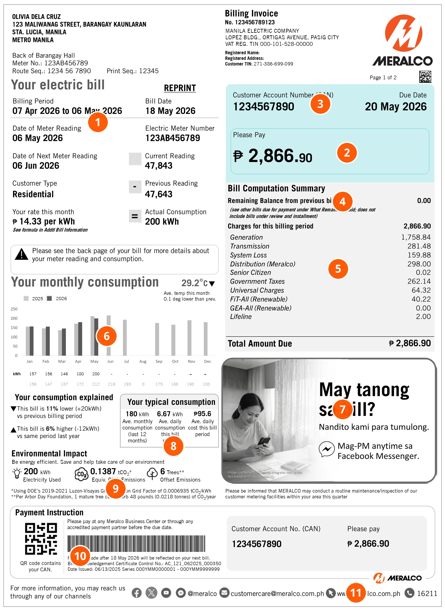
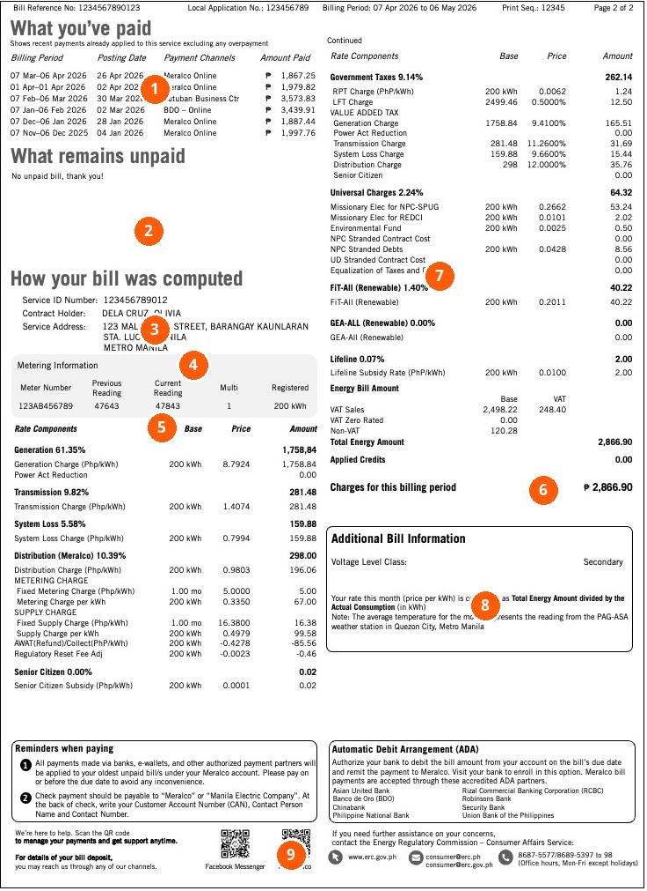
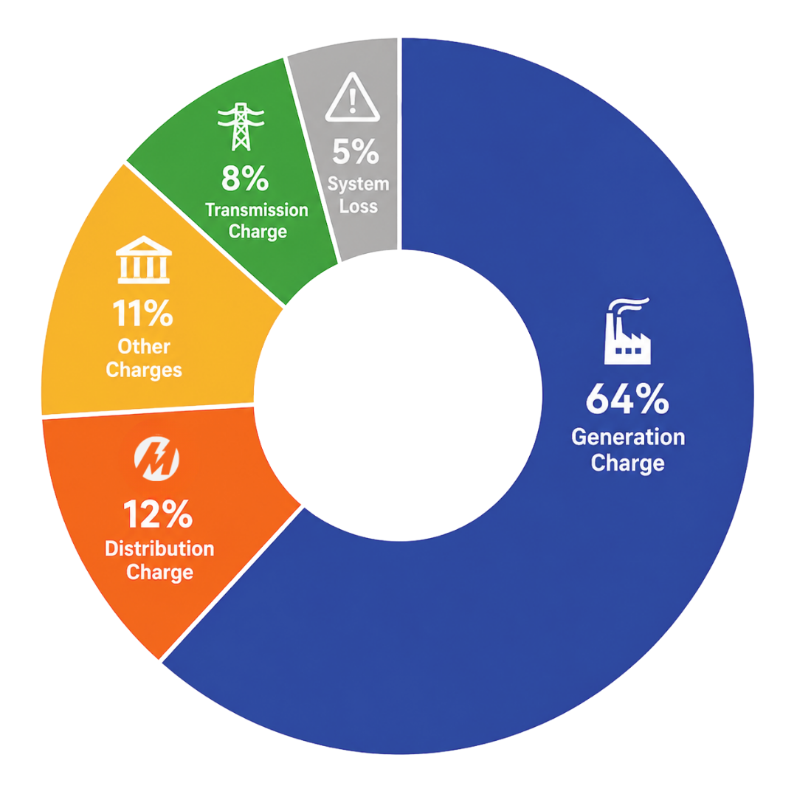
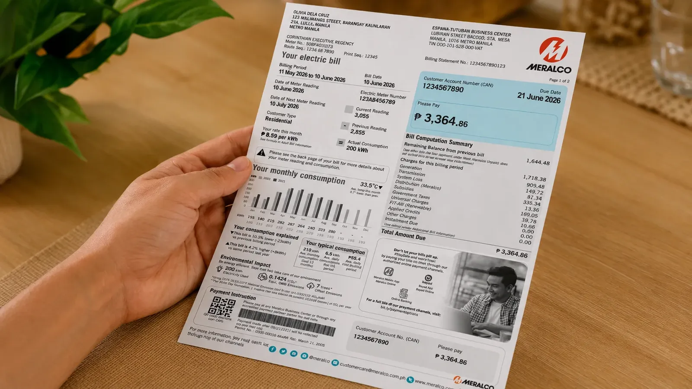

# Meralco Know Your Bill Official Reference

Meralco's residential "Understand Your Bill" guide ([https://www.meralco.com.ph/residential/understand-your-bill](https://www.meralco.com.ph/residential/understand-your-bill)) explains the front and back sections of the June 2026 sample electricity statement, the 2025 average rate breakdown (updated May 1, 2026), factors that change monthly bills, and Energy Regulatory Commission (ERC) bill deposit rules.

## Front of the Bill: Key Account and Payment Details

The front page of the Meralco sample bill ([clean image](images/bill-explainer-front-june-2026.jpg), [annotated image](images/bill-explainer-front-june-2026-annotated.jpg), [official source](https://www.meralco.com.ph/uploads/images/bill-explainer-front-june-2026.jpg?v=1786237832)) contains 11 numbered sections in reading order:

| Marker | Section Name | Hotspot Position (X, Y) | Official Description | Sample Bill Value Shown |
| :--- | :--- | :--- | :--- | :--- |
| 1 | Electric bill summary | `22%, 20%` | Provides an overview of the account, billing period, meter reading, actual consumption, rate, payment details, and bill-computation summary shown on the sample. | Billing Period: `07 Apr 2026 to 06 May 2026`; Bill Date: `18 May 2026`; Meter No.: `123AB456789`; Current Reading: `47,843`; Previous Reading: `47,643`; Actual Consumption: `200 kWh`; Rate: `P14.33 per kWh` |
| 2 | Payment information | `78%, 25%` | Groups and highlights the amount due and due date for immediate reference. Customers should check any account-specific notice before paying. | Due Date: `20 May 2026`; Please Pay: `P2,866.90` |
| 3 | Customer Account Number (CAN) | `72%, 17%` | Identifies the customer account for payments through supported channels and account inquiries with Meralco. One account can cover multiple electric services. | CAN: `1234567890` (Customer: `Olivia Dela Cruz`, `Residential`) |
| 4 | Bill computation summary | `77%, 33%` | Combines any remaining balance, current-period charges, installment amounts due, applied credits or adjustments, and the resulting total amount due. | Remaining Balance: `0.00`; Generation: `1,758.84`; Transmission: `281.48`; System Loss: `159.88`; Distribution (Meralco): `298.00`; Senior Citizen: `0.02`; Government Taxes: `262.14`; Universal Charges: `64.32`; FiT-All: `40.22`; GEA-All: `0.00`; Lifeline: `2.00`; Total Amount Due: `P2,866.90` |
| 5 | Distribution-related charges | `76%, 44%` | Shows the portion of the bill breakdown for delivering electricity through Meralco's distribution network and serving customers, distinct from the total electricity bill. | Distribution (Meralco): `P298.00` |
| 6 | Monthly consumption tracker | `24%, 55%` | Compares the current billing period with earlier months. Customers should check billing days and seasonal conditions when evaluating consumption changes. | 2025 vs. 2026 monthly bar chart (`Jan: 157 kWh`, `Feb: 156 kWh`, `Mar: 146 kWh`, `Apr: 180 kWh`, `May: 200 kWh`; Ave. temp: `29.2 C`, `11% lower (+20kWh) vs previous billing period`, `6% higher (-12kWh) vs same period last year`) |
| 7 | Bill announcement | `77%, 67%` | Displays customer information, program notices, policy updates, safety reminders, or account-specific messages. | Notice box ("May tanong sa bill? Nandito kami para tumulong. Mag-PM anytime sa Facebook Messenger.") and routine meter maintenance advisory |
| 8 | Typical consumption tracker | `39%, 73%` | Shows average monthly and daily use in kWh and the estimated daily peso cost (estimate shown on the sample bill to illustrate normal usage patterns). | Ave. monthly consumption (last 12 months): `180 kWh`; Ave. daily consumption this bill period: `6.67 kWh`; Ave. daily cost this bill period: `P95.6` |
| 9 | Environmental impact | `26%, 80%` | Converts sample consumption into an estimated greenhouse-gas equivalent and an energy-efficiency prompt (an estimate rather than a meter measurement). | Electricity Used: `200 kWh`; Equiv. GHG Emissions: `0.1387 tCO2` (using DOE 2019-2021 Luzon-Visayas Grid Emission Factor of `0.0006935 tCO2/kWh`); Offset Emissions: `6 Trees` |
| 10 | CAN QR code or barcode | `18%, 91%` | Allows supported payment channels to scan and populate the CAN automatically. Customers should verify the account details and amount before completing payment. | Payment Instruction QR code and barcode containing CAN `1234567890` |
| 11 | Contact information | `80%, 97%` | Lists official Meralco channels on the current bill for account inquiries, service requests, and billing concerns. | `@meralco`, `customercare@meralco.com.ph`, `www.meralco.com.ph`, hotline `16211` |

## Back of the Bill: Detailed Computation and Metering

The back page of the Meralco sample bill ([clean image](images/bill-explainer-back-june-2026.jpg), [annotated image](images/bill-explainer-back-june-2026-annotated.jpg), [official source](https://www.meralco.com.ph/uploads/images/bill-explainer-back-june-2026.jpg?v=1786237832)) contains 9 numbered sections explaining how the total bill is calculated:

| Marker | Section Name | Hotspot Position (X, Y) | Official Description | Sample Bill Value Shown |
| :--- | :--- | :--- | :--- | :--- |
| 1 | What you've paid | `24%, 10%` | Lists recent payments and credits associated with the service, including billing period, posting date, payment channel, and amount when present. | Six prior monthly payments (`Meralco Online`, `Tutuban Business Ctr`, `BDO - Online`) ranging from `P1,867.25` to `P3,573.83` |
| 2 | What remains unpaid | `23%, 26%` | Displays earlier unpaid bills, their billing periods and due dates, the total unpaid balance, and any account-specific status or remarks. | `No unpaid bill, thank you!` |
| 3 | Bill breakdown | `24%, 37%` | Shows the detailed computation behind the current bill, listing each rate component, billed quantity or basis, rate, and amount. | Section heading `How your bill was computed` |
| 4 | Service ID Number | `30%, 41%` | Uniquely identifies the electric service covered by the detailed bill. Used alongside the CAN when secure support processes require both identifiers. | Service ID Number: `123456789012` (Contract Holder: `DELA CRUZ, OLIVIA`) |
| 5 | Metering information | `25%, 48%` | Lists the meter number, current and previous readings, reading dates, multiplier or other billing determinant when applicable, and the resulting consumption. | Meter Number: `123AB456789`; Previous Reading: `47643`; Current Reading: `47843`; Multiplier: `1`; Registered: `200 kWh` |
| 6 | Total energy amount | `84%, 55%` | Shows the peso amount for electricity used during the current billing period before or combined with the other bill components shown. | VAT Sales: `2,498.22` (VAT: `248.40`); Non-VAT: `120.28`; Total Energy Amount: `2,866.90`; Applied Credits: `0.00`; Charges for this billing period: `P2,866.90` |
| 7 | Rate components | `68%, 31%` | Lists generation, transmission, system loss, distribution-related, subsidy, tax, universal, renewable-energy, and other ERC-approved components applied to the account. | Generation (`61.35%`, `P1,758.84`), Transmission (`9.82%`, `P281.48`), System Loss (`5.58%`, `P159.88`), Distribution (`10.39%`, `P298.00`), Senior Citizen (`0.00%`, `P0.02`), Government Taxes (`9.14%`, `P262.14`), Universal Charges (`2.24%`, `P64.32`), FiT-All (`1.40%`, `P40.22`), GEA-All (`0.00%`, `P0.00`), Lifeline (`0.07%`, `P2.00`) |
| 8 | Additional bill information | `75%, 68%` | Records account-specific adjustments, installment details, applied credits, refunds or collections, and other computation notes. | Voltage Level Class: `Secondary`; formula note (`Total Energy Amount divided by the Actual Consumption (in kWh)`) and PAG-ASA Quezon City weather station note |
| 9 | Authorized payment-partner information | `45%, 96%` | Provides a QR code or link to identify Meralco's currently authorized payment partners. Customers should verify that the destination uses an official Meralco domain before proceeding. | QR codes for `Facebook Messenger` and `My Meralco`, plus Automatic Debit Arrangement (ADA) partner banks |

## Breakdown of Charges (2025 Average, Updated May 1, 2026)

All bill components follow Philippine law and Energy Regulatory Commission (ERC) rules ([local chart image](images/breakdown-of-charges-2025.png), [official source](https://www.meralco.com.ph/uploads/images/historical-source/residential-breakdown-source/source-92013c2991fa757c5161217ae5ce064c600b2ac3d48ce68e7d6bff2688aff794.png?v=1790843647)). Based on the 2025 average residential bill, 12% goes to Meralco and 88% consists of pass-through charges collected for power suppliers, the grid operator, and government agencies.

| Charge Component | 2025 Average Share | Recipient / Remittance Target | What It Covers |
| :--- | :--- | :--- | :--- |
| Generation Charge | 64% | Power suppliers (IPPs, PSA holders, WESM, Net Metering/DER participants) | Cost of power purchased from Independent Power Producers (IPPs), Power Supply Agreement (PSA) holders, the Wholesale Electricity Spot Market (WESM), and exported energy from Net Metering and Distributed Energy Resource (DER) participants. Regulated by the ERC to ensure lowest-cost sourcing. |
| Distribution Charge | 12% | Meralco | Cost of building and maintaining the distribution network, delivering electricity safely and reliably, and customer service, metering, and billing. Meralco has not increased its distribution charges since 2015. |
| Other Charges | 11% | National government, LGUs, PSALM, TransCo, NPC | Government-mandated taxes, subsidies, renewable energy allowances, and universal charges (detailed below). |
| Transmission Charge | 8% | National Grid Corporation of the Philippines (NGCP) | Cost of delivering electricity from power plants to Meralco's system over transmission lines, plus ancillary services for grid stability and reliability. |
| System Loss Charge | 5% | Generation companies and NGCP | Technical and non-technical electricity losses during generation and transmission. Subject to an ERC-mandated system loss cap; losses above the cap cannot be passed on to customers. |

### Components of Other Charges (11%)

1. **Government Taxes**:
   - **Value Added Tax (VAT) and Energy Tax** (for residential customers consuming over 650 kWh): Remitted to the national government.
   - **Real Property Tax and Local Franchise Tax**: Remitted to Local Government Units (LGUs).
2. **Lifeline Subsidy**: Provides bill discounts to 4Ps beneficiaries and certified marginalized customers consuming 100 kWh and below; remitted to Power Sector Assets and Liabilities Management (PSALM).
3. **Senior Citizen Subsidy**: Provides bill discounts to senior citizens consuming 100 kWh and below and to DSWD-accredited institutions for the elderly.
4. **Feed-in Tariff Allowance (FiT-All)**: Supports renewable energy projects under the Feed-in Tariff Program; set annually by the ERC and remitted to the National Transmission Corporation (TransCo).
5. **Green Energy Auction Allowance (GEA-All)**: Funds solar, wind, and hydro projects selected through competitive bidding under the government's Green Energy Auction Program (GEAP); remitted to TransCo.
6. **Universal Charges** (remitted to PSALM):
   - **Missionary Electrification**: Funds electricity service in remote or off-grid communities unconnected to the national transmission grid.
   - **Environmental Charge**: Fixed at P0.0025/kWh for watershed rehabilitation and management, managed by the National Power Corporation (NPC).
   - **NPC Stranded Debts**: Covers unpaid financial obligations of the NPC.

## Five Reasons a Monthly Bill Changes

Meralco identifies five factors that cause month-to-month bill variations ([https://www.meralco.com.ph/residential/understand-your-bill#SolutionsFaq-2168](https://www.meralco.com.ph/residential/understand-your-bill#SolutionsFaq-2168)):

1. **Electricity use changed**: Weather, household occupancy, appliance use, and operating hours alter total kWh consumption.
2. **Billing period length differed**: A billing cycle with more or fewer days changes total kWh; compare daily consumption alongside total kWh.
3. **Rates or pass-through charges changed**: Generation, transmission, tax, and other ERC-approved rates fluctuate by billing period.
4. **A meter reading or adjustment was posted**: Estimated readings, billing corrections, credits, or prior-period adjustments change the billed amount.
5. **A prior balance or payment changed**: Unpaid previous balances, payment posting dates, and account credits affect the total due.

## Bill Deposit Rules and Annual Review Outcomes

A bill deposit is a payment guarantee based on estimated electricity use when service starts ([https://www.meralco.com.ph/residential/understand-your-bill#BillDepositGuide-2174](https://www.meralco.com.ph/residential/understand-your-bill#BillDepositGuide-2174)). It earns interest under ERC rules, and Meralco reviews its adequacy annually around the service-contract anniversary by comparing the deposit plus accumulated interest against the previous 12 months' average monthly bill.

| Annual Review Condition | Outcome | Mechanism and Notification | Official Calculation Example (Sep 2019 to Aug 2020 Average Bill: P1,000.00) |
| :--- | :--- | :--- | :--- |
| Deposit + interest is **more than 10% above** the 12-month average bill | Customer receives a refund | Excess deposit and applicable interest are credited to the bill; communicated by letter or in the Applied Credits/Other Charges section. | Deposit + interest: P1,500.00; Difference: P500.00; **Refund: P500.00** |
| Deposit + interest is **within 10%** of the 12-month average bill | Deposit stays the same | No refund or additional collection occurs; deposit remains subject to the next annual anniversary review. | Deposit + interest: P1,050.00; Difference: P50.00; **Result: No refund or collection** |
| Deposit + interest is **more than 10% below** the 12-month average bill | Additional deposit is collected | Shortfall is collected across 12 monthly installments starting after the annual review; communicated by letter or bill. | Deposit + interest: P800.00; Difference: P200.00; **Collection: P200.00 in 12 monthly installments** |

### Early Bill Deposit Refund (Starting May 2026)

Beginning May 2026, qualified residential customers receive their bill deposit and applicable interest automatically as a bill credit ([regulatory FAQs](https://www.meralco.com.ph/help/faqs/regulatory-faqs#faq-early-refund-bill-deposit-2)). Eligible customers include:
- Customers receiving the full Lifeline subsidy.
- Customers who paid on or before their due date consistently for the previous 24 months.

### Customers Required to Pay a Bill Deposit

Meralco requires a bill deposit from six customer categories ([https://www.meralco.com.ph/residential/understand-your-bill#LongformContent-100721](https://www.meralco.com.ph/residential/understand-your-bill#LongformContent-100721)):
1. New customers applying for electric service.
2. Existing customers applying for a transfer of service.
3. Existing customers applying for an increase in load or capacity.
4. Existing customers with disconnected services applying for reconnection who were not previously subject to a bill deposit.
5. Existing customers whose actual average monthly consumption over the past 12 months increased by more than 10% of their initial or existing bill deposit.
6. Existing customers who previously received an early bill deposit refund due to a good credit rating and later defaulted on monthly bill payments.

## Frequently Asked Bill Questions

Meralco's official FAQ section addresses four common billing inquiries ([https://www.meralco.com.ph/residential/understand-your-bill#SolutionsFaq-2178](https://www.meralco.com.ph/residential/understand-your-bill#SolutionsFaq-2178)):

- **Why is my bill higher this month?** Compare consumption, billing days, current rates, meter readings, adjustments, prior balances, and posted payments, as multiple factors can change simultaneously.
- **Where can I find my meter readings?** Check the Metering Information section on the bill for current and previous readings, meter details, and the consumption calculated for the billing period.
- **Does Meralco keep every charge on the bill?** No. Pass-through, tax, and universal charges (88% of the 2025 average bill) are collected for power generators, the transmission system (NGCP), government agencies, and other regulated funds.
- **How do I ask about a specific bill?** Prepare the Customer Account Number (CAN) and the bill, then contact Meralco through [My Meralco](https://mymeralco.com.ph/) or an official Meralco support channel.

## Related Official Links and Legal References

- **Meter Guide**: [Understanding Your Meter](https://www.meralco.com.ph/residential/understand-your-bill/about-your-meter)
- **Refunds and Discounts**:
  - [Meter Deposit Refund](https://www.meralco.com.ph/help/faqs/regulatory-faqs#faq-section-meter-deposit-refund) (covers historical meter deposits, including the December 31, 2017 claim deadline)
  - [ICERA Refund](https://www.meralco.com.ph/help/faqs/regulatory-faqs#faq-section-icera-refund) (refund implemented for 60 months starting February 2018)
  - [Senior Citizen Discount](https://www.meralco.com.ph/residential/understand-your-bill/senior-citizen-discount) (requirements and official application portal)
- **Legal References (ERC & DSOAR)**:
  - [Magna Carta for Residential Electricity Consumers (PDF)](https://www.meralco.com.ph/uploads/documents/legacy-documents/v2/unclassified/e8/meralco-doc-e88d3c7223cfd7cd.pdf?v=1788354348)
  - [Guidelines to Implement Articles 7, 8, 14 and 28 of the Magna Carta for Residential Electricity Consumers (PDF)](https://www.meralco.com.ph/uploads/documents/legacy-documents/v2/unclassified/7e/meralco-doc-7ed87c2fdff57787.pdf?v=1788353871)
  - [Amended Magna Carta for Residential Electricity Consumers (PDF)](https://www.meralco.com.ph/uploads/documents/legacy-documents/v2/unclassified/f2/meralco-doc-f210254fda4d1ba4.pdf?v=1788354394)
  - [Distribution Services and Open Access Rules (DSOAR) (PDF)](https://www.meralco.com.ph/uploads/documents/legacy-documents/v2/unclassified/6f/meralco-doc-6fd11f6b32b23526.pdf?v=1788353813)
