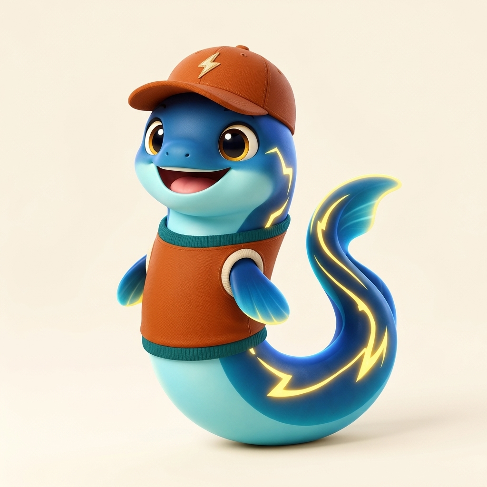
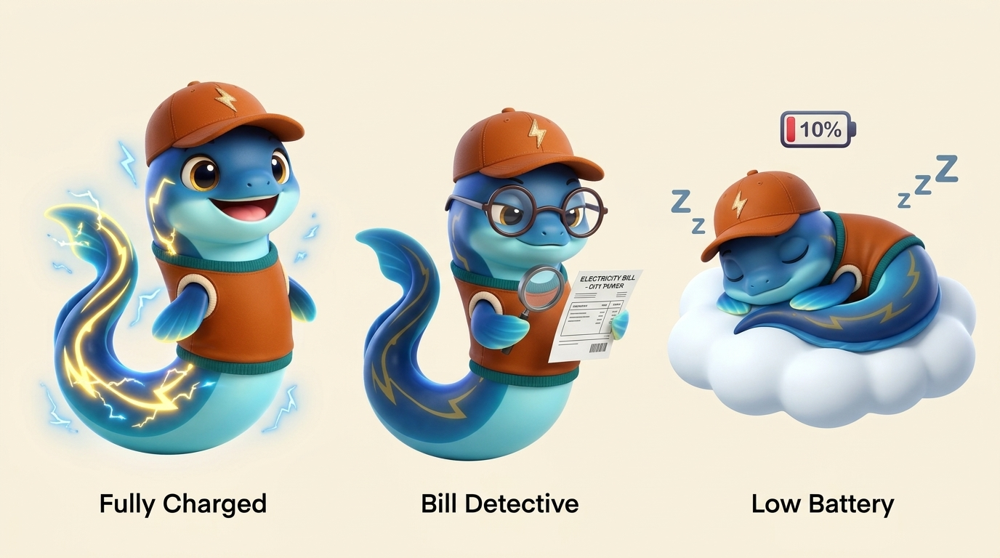
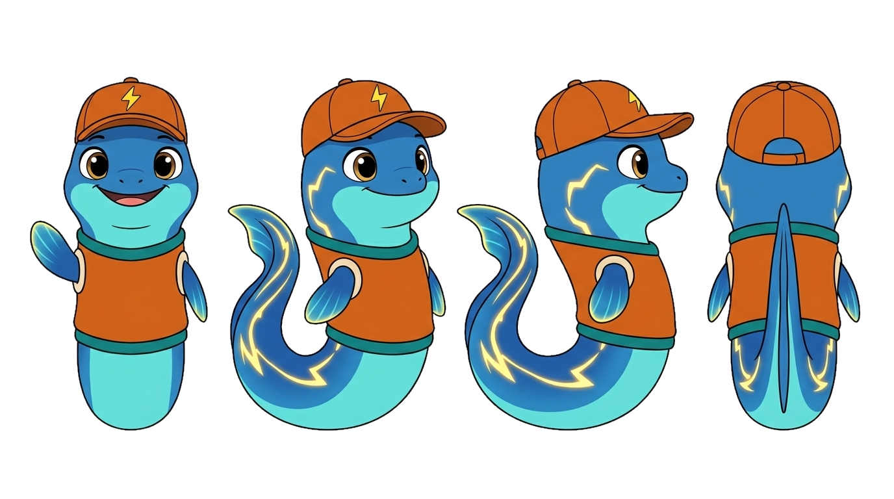
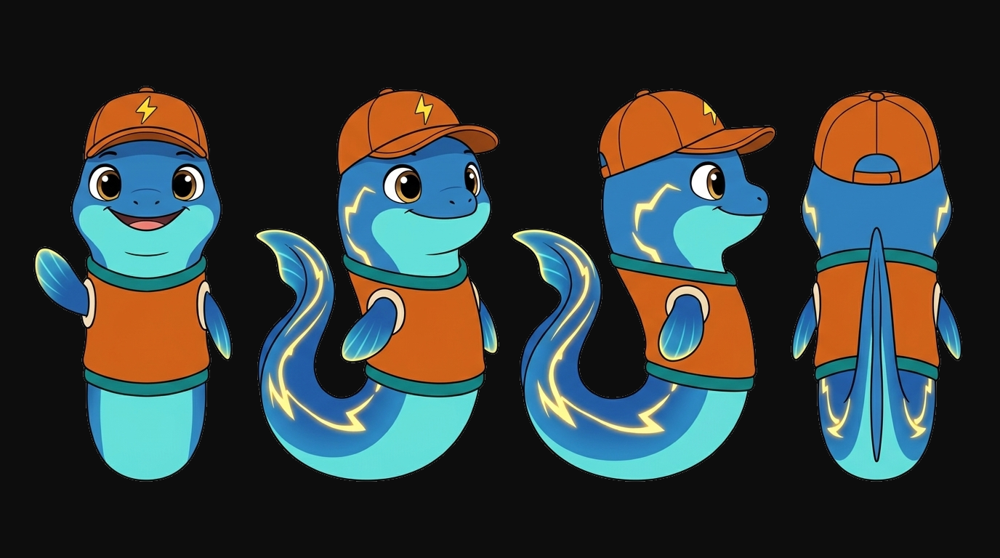
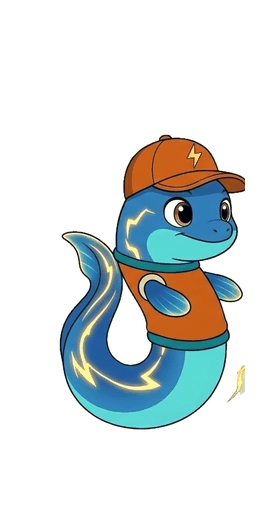
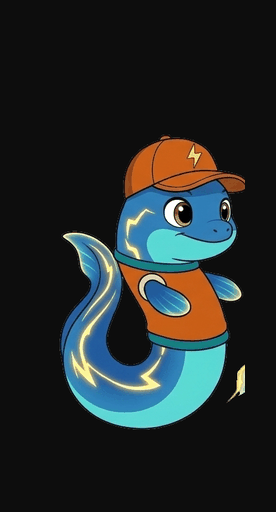
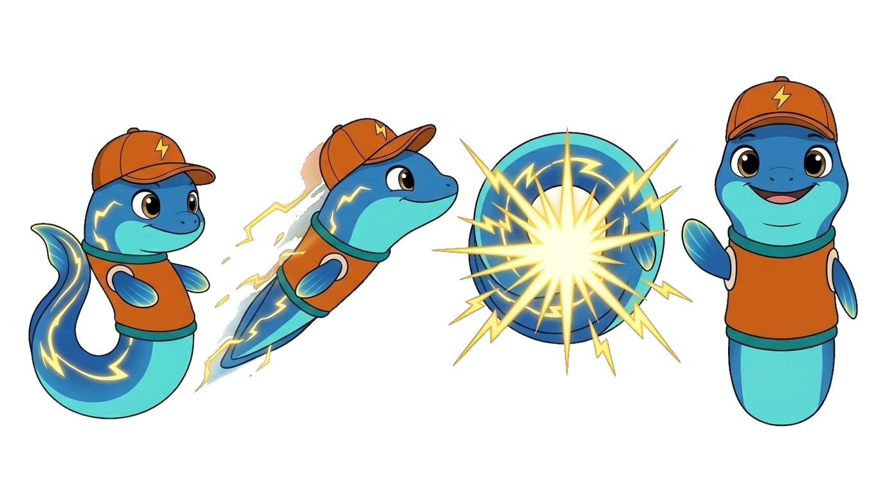
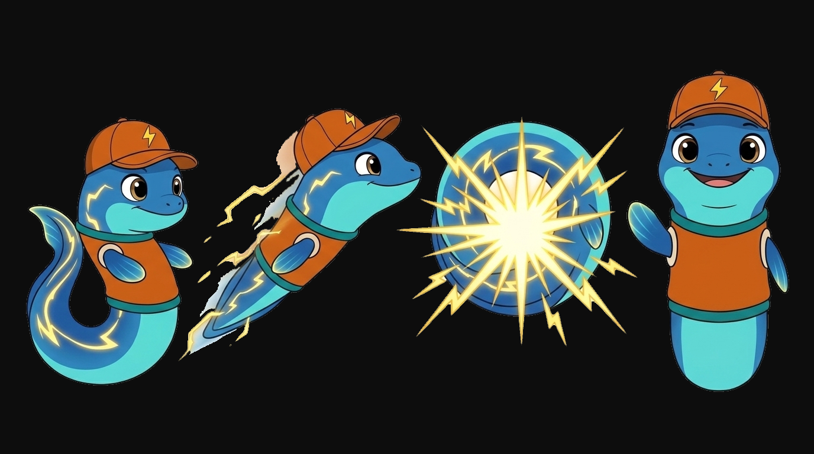

# Mascot & Brand Identity: Eelio

## 1. Brand Name & Meaning: **Eelio**

To directly address **Challenge #2: Know Your Bill, Manage Your Usage** ([official_challenges.png](../official-documents/official_challenges.png)), the project and its companion mascot are unified under a single name: **Eelio**.

| Element | Meaning & Wordplay | How It Connects to Challenge #2 |
| :--- | :--- | :--- |
| **Eel** | Nature's living battery (an electric eel that senses its surroundings with low-voltage pulses and manages its stored charge) | **Know Your Bill & Manage Your Usage:** Uses electric pulses to "see" in the dark (bill clarity) while conserving its own energy (usage management). |
| **Elio / Ilaw** | Derived from *Helios* (light/energy) and Tagalog *Ilaw* (light/clarity) | Shines light on the 20 confusing sections of a residential electricity bill. |
| **-io / Iyo** | *"Para sa iyo"* (For you) | Personalizes household bill decoding and daily energy-saving Missions. |

> **Unified Brand Identity:**
> - **Project & App Name:** **Eelio**
> - **Mascot Companion Name:** **Eelio**
> - **Core App Shell (Issues #48–#53):** **Home** (Bill Breakdown & Charge Chat) · **Missions** (5% Mission Plan, Appliance Tap Grid & Routine) · **Rewards** (Verified Savings & Points) · **Account** (CAN Linking)

---

## 2. Visual Anatomy & UI Theme Alignment (`GABlane/Larp-Ui-Ux`)

**Eelio** features the sleek, graceful **S-curve silhouette of an electric eel** with an approachable, expressive face. It keeps its natural **Electric Blue & Light Aqua** body with glowing golden lightning stripes ([eelio-reference.png](eelio-reference.png)) and wears a sporty **baseball cap and sweater-vest** tailored to the exact Tailwind UI tokens from `GABlane/Larp-Ui-Ux`:

| UI Token (`tailwind.config.js`) | Hex Value | Application on Eelio Mascot & Outfit |
| :--- | :--- | :--- |
| **Natural Eel Body** | Electric Blue & Aqua | Sleek S-curve electric eel body with soft aqua underbelly (complementary contrast against the warm UI canvas) |
| **`brand.DEFAULT` / `brand.hover`** | `#C2500C` / `#A84308` | Burnt-orange / terracotta baseball cap & sporty sweater-vest |
| **`info.DEFAULT`** | `#0F6E68` | Deep teal ribbed collar and hem trim on Eelio's vest |
| **`brand.soft` / `canvas`** | `#FDEEE3` / `#FAF6F0` | Warm cream armholes, cap lightning emblem, and `#FAF6F0` background canvas |
| **`ink.DEFAULT`** | `#1F1B16` | Warm espresso eyes, detective glasses frames, and typography |
| **`warn` / Amber Glow** | `#F59E0B` / `#FDF3DC` | Glowing golden lightning-bolt lateral line (living battery gauge) |

---

## 3. How Eelio Solves Challenge #2 (UX, Psychology & Anti-Mañana Gamification)

In [know-your-bill-official.md](../kyb/know-your-bill-official.md), residential customers face 20 numbered sections across the front and back of the Meralco bill, leading to cognitive overload and the **Mañana Habit** (*"Bukas na lang kami magtitipid"*).

Eelio counters both problems through **3 Gamified States**:

| Mascot State | Trigger in the App | Visual Expression | Psychological / UX Purpose |
| :--- | :--- | :--- | :--- |
| **1. Fully Charged Eelio** (*Manage Your Usage — Missions & Rewards Tabs*) | Household completes their 5% Mission Plan & earns Verified Savings Points | Floating in an energetic S-curve, bright golden lightning stripes sparking along its sides | Positive reinforcement that rewards verified energy-saving habits and keeps momentum going. |
| **2. Bill Detective Eelio** (*Know Your Bill — Home Tab & Charge Chat*) | User links their CAN, scans their Meralco bill, or taps a charge line to ask a question | Wearing round espresso-framed glasses, holding a magnifying glass beside the bill's kWh chart | Replaces cognitive overload with a clear, friendly 4-way breakdown (Rate, Billing Days, Weather, and Habit Effects) and stateless charge explanations. |
| **3. Low-Battery Eelio** (*Anti-Mañana Nudge*) | Household has not completed setup or is trending above their 5% Mission Plan forecast | Curled up in a cozy coil with its cap tilted over sleepy eyes, dimmed lightning stripes, and a 10% battery icon | Gentle visual reminder that prompts the household to act *today* rather than waiting for next month's bill shock. |

---

## 4. Multi-POV Character Turnaround & Asset Pipeline (`white-bg`, `no-bg`, `black-bg`)

Every Eelio mascot sheet and individual sliced pose is stored in three background variants under `docs/mascot/assets/`:
- **`docs/mascot/assets/no-bg/`**: True transparent PNGs (`RGBA`) for direct UI overlay on any card or sheet.
- **`docs/mascot/assets/white-bg/`**: Solid `#FFFFFF` background for light-mode documentation and print decks.
- **`docs/mascot/assets/black-bg/`**: Solid `#0D0D0D` dark canvas for testing dark-mode contrast and bioluminescent lightning glow.

### Multi-Angle Turnaround (Front · 3/4 Left · Side Profile · Back)
- **White BG:** [eelio-turnaround-sheet.png](assets/white-bg/eelio-turnaround-sheet.png) (Individual slices: `eelio-pov-1-front.png`, `eelio-pov-2-three-quarter-left.png`, `eelio-pov-3-side-right.png`, `eelio-pov-4-back.png`)
- **Transparent (`no-bg`):** [eelio-turnaround-sheet.png](assets/no-bg/eelio-turnaround-sheet.png)
- **Black BG:** [eelio-turnaround-sheet.png](assets/black-bg/eelio-turnaround-sheet.png)

---

## 5. Frame-by-Frame Screen Transition Plan ("Electric Dash")

To keep the phone-first PWA fast and lightweight without heavy video files, screen transitions use a **4-frame sprite sequence** (`eelio-frame-1-coil.png` → `eelio-frame-2-dash.png` → `eelio-frame-3-spark-loop.png` → `eelio-frame-4-arrive.png`) paired with CSS spring motion:

- **White BG Sheet:** [eelio-transition-sheet.png](assets/white-bg/eelio-transition-sheet.png)
- **Transparent (`no-bg`) Sheet:** [eelio-transition-sheet.png](assets/no-bg/eelio-transition-sheet.png)
- **Black BG Sheet:** [eelio-transition-sheet.png](assets/black-bg/eelio-transition-sheet.png)

### Live Animation Preview ("Electric Dash" Loop)

- **Transparent Animated GIF:** [eelio-electric-dash-animation.gif](assets/no-bg/eelio-electric-dash-animation.gif)
- **White BG Animated GIF:** [eelio-electric-dash-animation.gif](assets/white-bg/eelio-electric-dash-animation.gif)
- **Black BG Animated GIF:** [eelio-electric-dash-animation.gif](assets/black-bg/eelio-electric-dash-animation.gif)

### Frame-by-Frame Sprite Breakdown

1. **Frame 1 — Coil (`eelio-frame-1-coil.png`):** Coils in anticipation, storing electrical potential energy before a leap.
2. **Frame 2 — Dash (`eelio-frame-2-dash.png`):** Streamlined horizontal sprint with lightning trail.
3. **Frame 3 — Spark Loop (`eelio-frame-3-spark-loop.png`):** Discharging electric pulses during loading or OCR wait states.
4. **Frame 4 — Arrive (`eelio-frame-4-arrive.png`):** Decelerating and sticking the landing as content reveals.

| Screen Transition | Frame Sequence Used | Timing & Motion | Purpose in UX |
| :--- | :--- | :--- | :--- |
| **1. Sign-In → Link CAN (#45 → #46)** | `pov-1-front` → `frame-1-coil` → `frame-2-dash` → `pov-2-three-quarter-left` | `320ms` ease-out horizontal slide | Guides the user from email OTP verification into linking their Meralco CAN. |
| **2. Link CAN → Bill Scan (#46)** | `frame-1-coil` ↔ `frame-3-spark-loop` (looping while AI reads bill) → `Bill Detective` | Continuous `600ms` cycle during OCR, then spring pop on match | Turns the 2–3 second Gemini Vision wait into an engaging electric charge animation. |
| **3. Home Tab → Charge Chat Sheet (#49 → #50)** | `Bill Detective` → `pov-1-front` peeking over the bottom sheet header | `220ms` upward spring (`cubic-bezier(0.34, 1.56, 0.64, 1)`) | Makes tapping any charge line (Generation, System Loss, etc.) feel like asking Eelio directly. |
| **4. Home ("Want to Save?") → Missions Setup (#51 → #52)** | Full 4-frame sequence (`frame-1-coil` → `frame-2-dash` → `frame-3-spark-loop` → `frame-4-arrive`) | `450ms` total (`100ms` per frame + `50ms` settle) | Celebrates starting the "+100 Welcome Points" setup and energizes the Appliance Tap Grid. |
| **5. Completing Setup / Redeeming Reward (#52 / #19)** | `frame-3-spark-loop` → `Fully Charged` / `frame-4-arrive` | `380ms` pop with golden spark burst | Rewards the user visually when unlocking their 5% Mission Plan or redeeming Points. |

