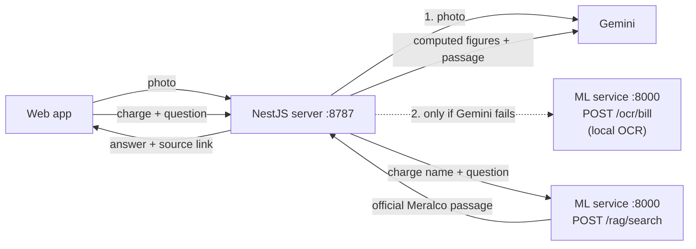

# Bill OCR and RAG: how they work and how to set them up

Eelio has two machine-learning parts, both in the **ML service** (`ml-service/`, Python + FastAPI), separate from the NestJS backend (`server/`):

| Part | What it does | Used by |
|---|---|---|
| **OCR** (`POST /ocr/bill`) | Reads a photo of a Meralco Bill on our own machine: kWh, billing period, readings, CAN, charge lines, 12-month history | Bill scan, as the **fallback** when Gemini can't read the photo (or the only reader with `VISION_PROVIDER=ml`) |
| **RAG** (`POST /rag/search`) | Finds the official Meralco explanation of a charge (e.g. "Generation") in Meralco's public "Understand Your Bill" guide | Charge chat: the passage goes to Gemini as context and shows under the answer as "From Meralco's bill guide" |

Both are optional at runtime: if the ML service is not running, the app still works (see [What happens when something is down](#what-happens-when-something-is-down)).

Background: issue #68 (privacy of bill photos sent to a cloud AI) and the hackathon rule against data-privacy breaches.

---

## 1. How it fits together



**Bill scan** (`POST /api/bills/scan`), chosen by `VISION_PROVIDER` in `server/.env`:

| Value | Who reads the Bill |
|---|---|
| `gemini-ml` (default) | Gemini first. If Gemini **fails** (no key, quota used up, an error, or no answer within 15 s), the ML service reads the same photo. If Gemini answers "unreadable", that is final and the customer retakes the photo. |
| `gemini` | Gemini only. |
| `ml` | ML service only. The photo never leaves our machine. |

Energy label and aircon photos always use Gemini; the ML service only reads Bills.

**Charge chat** (`POST /api/households/:sin/charges/:lineId/ask`): NestJS computes the line's figures, asks the ML service for the matching Meralco passage, and gives both to Gemini to word the answer. Every ₱ and kWh in Gemini's answer must come from the computed figures, or the template answer is used instead.

---

## 2. Setup

### What you need

- Node.js 22 and pnpm (already needed for the app)
- **Python 3.10 or newer** (`python3 --version`; on Windows `python --version`)
- About 500 MB of disk for the Python packages. No GPU needed. Internet only for the first install.

### Step 1: install the ML service (once)

Linux / macOS:

```sh
cd ml-service
python3 -m venv .venv
.venv/bin/pip install -r requirements.txt
```

Windows (PowerShell):

```powershell
cd ml-service
python -m venv .venv
.venv\Scripts\pip install -r requirements.txt
```

The OCR models come inside the `rapidocr` package, so nothing else is downloaded later.

### Step 2: settings in `server/.env`

> **The server reads `server/.env` only**, not the `.env` at the repo root. A key in the root `.env` is ignored, and the scan answers 503 "Bill scan is not set up yet."

```sh
cp server/.env.example server/.env   # if you don't have one yet
```

Then set (see `server/.env.example` for every option):

```ini
GEMINI_API_KEY=<your key from https://aistudio.google.com>
GEMINI_MODEL=<a model your key can use, e.g. the one that works for your team>
VISION_PROVIDER=gemini-ml
ML_SERVICE_URL=http://127.0.0.1:8000
```

| Setting | Default | Meaning |
|---|---|---|
| `VISION_PROVIDER` | `gemini-ml` | Who reads Bill photos (table above) |
| `ML_SERVICE_URL` | `http://127.0.0.1:8000` | Where NestJS finds the ML service |
| `VISION_PRIMARY_TIMEOUT_MS` | `15000` | How long to wait for Gemini before using the ML service |
| `GEMINI_API_KEY`, `GEMINI_MODEL` | none, `gemini-3.8-flash` | Gemini for scanning and wording |

Never commit `.env` files or paste keys in chat or screenshots. If a key leaks, delete it in AI Studio and make a new one.

### Step 3: run (two terminals)

Terminal 1, the ML service:

```sh
cd ml-service
.venv/bin/uvicorn app.main:app --port 8000        # Windows: .venv\Scripts\uvicorn app.main:app --port 8000
```

Wait for `Application startup complete` (a few seconds: it loads the OCR models).

Terminal 2, the app:

```sh
pnpm dev        # API on :8787, web on :5173
```

Restart `pnpm dev` whenever you change `server/.env`; settings are read only at startup.

### Step 4: check it works

1. http://127.0.0.1:8000/health should show `{"status":"ok","ocrModelLoaded":true,"knowledgePassages":16}`.
2. http://127.0.0.1:8000/docs lets you try both endpoints in the browser:
   - `/rag/search` with `{"lineLabel": "Generation", "question": "Bakit tumaas?", "k": 2}` returns the Generation Charge passage first.
   - `/ocr/bill`: upload a bill photo; you get the read values in about 10 s.
3. In the app: scan a Bill, then tap a charge on Home and ask a question. "From Meralco's bill guide" should appear under the answer.

---

## 3. The OCR, step by step

Code: `ml-service/app/ocr/`.

1. **Read the photo in memory** (`engine.py`). The phone's rotation flag (EXIF) is applied and large photos are scaled to 2400 px. The photo is never written to disk and is dropped when the request ends.
2. **Find the text** with **RapidOCR**: PaddleOCR's detection and recognition models running on ONNX Runtime, on the CPU, offline. Each piece of text comes back as a box with its four corners.
3. **Straighten the page** (`layout.py`). Phone photos are rarely level. The tilt is estimated from the long text boxes (their top edges should be horizontal), and every box is rotated back. Without this, a charge name and its amount on a tilted photo end up on different "lines" and the charge is lost.
4. **Pick out the values** (`bill_parser.py`), using only Meralco's printed labels:

   | Field | How it is found |
   |---|---|
   | Billing period, billing days | "07 Apr 2026 to 06 May 2026" → period `2026-05`, 30 days (Meralco counts both ends) |
   | Due date | The date under or beside "Due Date" |
   | CAN | The 10 digits under "Customer Account Number (CAN)" |
   | kWh | "Actual Consumption … 200 kWh" (skipping "₱14.33 per kWh") |
   | Readings | The numbers under "Previous Reading" and "Current Reading" |
   | Charge lines | Between "Charges for this billing period" and "Total Amount Due", each name paired with the amount on the same straightened line |
   | History | The "kWh" row of the monthly chart, plus last year's row so a January Bill still finds December |

5. **Sanity checks.**
   - The present reading must equal the previous reading plus kWh. If not, the parser looks for the printed number that fits, and never accepts a year (like `2026`) as a reading.
   - `chargesAddUp` says whether the charge lines add up to the printed total.
   - Anything not found stays empty for the customer to type on the "Is this right?" screen.
6. **Privacy.** The parser never extracts the name, address or meter number. `?debug=true` returns the raw OCR lines (which do include them) and is for local debugging only.

Speed: about 8 to 10 s per photo on a laptop CPU (Gemini: 2 to 4 s).

---

## 4. The RAG, step by step

Code: `ml-service/app/rag/`, `server/src/knowledge/`, `server/src/charge-chat/`.

1. **Knowledge base**: `ml-service/app/rag/meralco-knowledge.json`, 16 short passages written from Meralco's public "Understand Your Bill" guide (`docs/kyb/know-your-bill-official.md`): one per charge (Generation, Transmission, System Loss, Distribution, taxes, Lifeline, Senior Citizen, FiT-All, GEA-All, Universal Charges) plus general answers (why a bill changes, does Meralco keep every charge, where to find meter readings, how to ask Meralco). Each passage keeps its meralco.com.ph source link. No customer data.
2. **Retrieval** (`search.py`): BM25 keyword scoring over the passages, plus a strong boost for the passage written for the tapped charge's type, so tapping "Generation" always ranks the Generation passage first. Common Tagalog question words are expanded to the English the guide uses (`bakit` → why, `tumaas` → higher, `sino` → who). No embedding model and no network: with 16 short official passages, keyword matching is exact, explainable and instant.
3. **What NestJS sends** to `/rag/search`: only the charge's name and the question. No CAN, SIN, email or amounts. It waits at most 1.5 s, and it keeps only passages that link to meralco.com.ph.
4. **Generation**: Gemini gets the line's computed figures plus the passages as "Official Meralco reference (public text … never as a source of ₱ or kWh figures)". The server rejects any answer whose ₱ or kWh figure is not in the computed facts and uses the template instead.
5. **Shown to the customer**: the top passage, with its link, under every answer (AI or template) as "From Meralco's bill guide".

### Adding or editing a passage

1. Add an entry to `meralco-knowledge.json`:
   ```json
   {
     "id": "short_id",
     "charges": ["generation"],
     "title": "Shown as the source title",
     "text": "Plain public text from Meralco. No customer data.",
     "source": "https://www.meralco.com.ph/..."
   }
   ```
   `charges` lists the charge types it explains (see `CHARGE_TYPES` in `search.py`); use `[]` for general topics. `source` must be a meralco.com.ph page, or NestJS drops the passage.
2. Restart the ML service and run its tests (below). `test_rag.py` checks the passage count (update it) and that every source is a Meralco page.

---

## 5. What happens when something is down

| Situation | Bill scan | Charge chat |
|---|---|---|
| Everything up | Gemini reads it | AI answer + Meralco passage |
| Gemini out of quota, failing, or no key; ML service up | ML service reads it (about 10 s) | Template answer + Meralco passage |
| ML service down, Gemini fine | Gemini reads it | AI answer, no passage |
| Both down | 503 "Bill scan is not set up yet." (or 502 if Gemini had a real error) | Template answer, no passage |

The NestJS terminal says when the fallback is used:
`Bill scan: Gemini could not read the photo (HTTP 429: ...); reading it with the ML service instead.`
The ML service terminal shows `POST /ocr/bill ... 200` for each photo it read.

---

## 6. Tests

```sh
cd ml-service && .venv/bin/python -m pytest -q     # about 30 s, includes real OCR on Meralco's public sample bill
pnpm test                                          # NestJS + web, the ML service is faked
```

| Test file | What it proves |
|---|---|
| `ml-service/tests/test_bill_parser.py` | Every field of the sample Bill; tilts from -8° to 8°; a year is never taken as a reading; the name and address are never returned |
| `ml-service/tests/test_api.py` | `/ocr/bill` on the real photo and on a photo rotated 5°; bad files rejected (400, 413); `/rag/search`; `/docs` |
| `ml-service/tests/test_rag.py` | The tapped charge's passage ranks first for every line on the 2026 Bill; Tagalog questions; sources are Meralco pages |
| `server/test/fallback-vision.provider.spec.ts` | Gemini first, ML service on quota, missing key, error or timeout; the right 503/502 when both fail |
| `server/test/ml-vision.provider.spec.ts` | The photo is uploaded as `photo`; service down → 503; service error → 502 |
| `server/test/ml-knowledge.source.spec.ts`, `charge-chat.e2e-spec.ts` | Only the charge name and question reach `/rag/search`; passages reach Gemini and the answer; the chat works with the ML service down |

The test fixtures come from Meralco's public sample Bill (`docs/kyb/images/bill-explainer-front-june-2026.jpg`, a fictional customer). **Never add a real customer's bill photo or its OCR text to the repo**: the repository is public.

---

## 7. Troubleshooting

| Symptom | Cause and fix |
|---|---|
| Scan answers **503** "Bill scan is not set up yet." | No reader available. The Gemini key is not in **`server/.env`** (the root `.env` is ignored), and the ML service is not running or `ML_SERVICE_URL` is wrong. Fix either, then restart `pnpm dev`. |
| Scan answers **502** | A reader failed for a real reason. The NestJS terminal shows it (e.g. HTTP 429 quota, 404 unknown model, invalid key). |
| Gemini's free quota is used up | With `gemini-ml`, scans continue on the ML service automatically. Try another `GEMINI_MODEL` (Flash-Lite models have a higher free quota), or use a teammate's key from their own Google project (limits are per project). |
| `"status": "unreadable"` | The photo could not be read. Lay the Bill flat in good light and take the photo from directly above, with the whole page in the frame. |
| Some charges are missing, or a reading is empty | Retake the photo flatter. Try it at `/docs` → `/ocr/bill` with `debug=true` to see the raw OCR lines. |
| No "From Meralco's bill guide" under answers | The ML service is not running, or NestJS can't reach `ML_SERVICE_URL`. The NestJS terminal warns once: `ML service retrieval unavailable at ...`. |
| `pip install` fails on Windows | Use Python 3.10 to 3.13 from python.org, and make sure `python` is on PATH. |
| Port 8000 is taken | Run `uvicorn app.main:app --port 8001` and set `ML_SERVICE_URL=http://127.0.0.1:8001`. |

---

## 8. Known limits

- The parser targets Meralco's current Bill layout (the June 2026 sample). A new layout needs new label rules and a new fixture test.
- Only the front page of the Bill is read.
- OCR on a laptop CPU takes about 10 s. A GPU or a server with more cores is faster.
- The RAG covers 16 passages. Questions outside them get no passage; the answer still comes from the Bill's own figures.
- In `gemini-ml` mode the photo goes to Google first. For real customer bills in production, use `ml` (or run the reader on Meralco's own servers).
